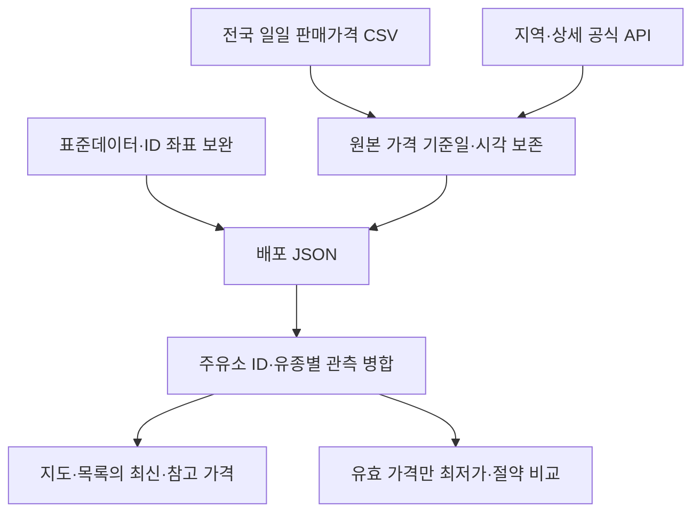

# 주유한눈

**정유사에 관계없이 주유 가격·가격 기준시각·추가 이동 비용을 비교하는 지도 앱.**

- 서비스: [주유한눈](https://softm.github.io/juyuhannun/)
- 추가 정보: [평균유가·고속도로·수소 월평균 안내](https://softm.github.io/juyuhannun/energy.html)
- 저장소: [softm/juyuhannun](https://github.com/softm/juyuhannun)
- 기준 소스: [돌봄한눈](https://github.com/softm/homecare-nationwide-care-services-map/tree/6c3a1fa7a4283f8b53dc0ca6ff5bc9643c45e16d)
- 운영·연동: [OPERATIONS.md](./OPERATIONS.md)
- 공식 데이터 상세: [server/DATA_SOURCES.md](./server/DATA_SOURCES.md)
- 지도 재사용 이력: [public/shared/SOURCE.md](./public/shared/SOURCE.md)

## 현재 상태

오피넷 공개 전국 일일 판매가격 파일과 지역 API 관측을 수집해 지도·검색·필터·상세·찜·공유에 사용합니다. 같은 주유소 ID·유종의 관측을 병합하며 원래 가격 기준일·보고시각·수집시각·출처를 유지합니다. 지도와 목록은 오래된 자료도 참고 가격으로 표시하고, 최저가·절약액 비교는 최신 비교 기준을 충족하는 가격만 사용합니다. 전국·시도 평균 유가는 별도 집계 자료로 제공하며, 고속도로 실가격 HTTP 연동은 공식 응답 명세 확인이 남아 있습니다.

전국 일일 파일은 오피넷의 공개 내려받기 경로로 수집합니다. `OPINET_API_KEY`는 지역 가격·상세정보·평균 유가와 누락 좌표의 공식 ID 조회에 사용합니다. **일반 API 키가 없다는 이유만으로 전국 공개 파일까지 0건으로 간주하지 않습니다.** 임의의 주유소·가격을 실자료로 넣지 않습니다. 좌표가 없는 가격 자료는 현재 지도 영역과 연결할 수 없어 지도·목록에 나오지 않으며, 전체 지도 확보가 완료된 상태는 아닙니다.

현재 건수·원본 가격 기준일·마지막 수집시각·실패 여부는 [수집 현황](https://softm.github.io/juyuhannun/data-status.html)과 배포 워크플로 Summary에서 확인합니다. `EX_API_KEY`만 등록해도 고속도로 실가격이 연결되지는 않으며 `implementationReady: false`로 표시합니다. **가는 길 주유**는 돌봄한눈에서 운영 중인 Directions 프록시를 직접 사용하므로 이 저장소에 `PUBLIC_API_BASE`를 등록하거나 별도 Vercel 서버를 배포하지 않아도 됩니다.

가격의 정확성을 확인하는 운영 검증은 실제 키 연동 후 수행해야 합니다. 코드 검증과 배포 성공을 실가격 연동 성공으로 간주하지 않습니다.

## 기능

| 영역 | 기능 |
|---|---|
| 지도 | 네이버 지도, 실제 지도 대체 경로, 위치 요청, 현재 지도 영역에 따른 목록·마커 갱신, 배율별 마커 표시와 배율 유지 |
| 가격 | 휘발유·경유·고급휘발유·LPG, 전국 일일 파일과 지역 관측을 ID·유종별 병합. 유종·지역별 실제 확보 범위는 수집 현황에서 확인 |
| 필터 | 정유사, 셀프, 선택형 최신 비교 가능 가격, 이름·주소, 가격·직선거리·확인된 절약액 정렬. 기본은 참고 가격도 표시 |
| 신뢰도 | 상세 보고시각과 일일 가격 기준일 구분, 원본 시각 유지. 만료·미확인 가격은 참고 표시하고 최저가·절약액 비교에서 제외 |
| 이용 | 주유소 상세, 전화·외부 길찾기, 찜, 해당 주유소 중심의 공유 링크 |
| 가는 길 주유 | 출발지·목적지 기본 자동차 경로 주변 후보 탐색, 우선 후보의 실제 주유소 경유 경로 검증, 최대 우회 필터, 추천·최저가·최소 우회·경로 진행순, 경로 모의주행 |
| 비용 | 주유량·연비·선택 시간가치와 사용자가 명시한 기준 단가로 주유비·추가 연료비·통행료 차이·시간 비용을 계산. 기준 단가를 비우면 총비용·절약액을 표시하지 않음 |
| 평균 유가 | 전국·시도·시군구 평균, 유종·지역 필터, 전일 대비 증감, 기준일·수집 시각 분리 |
| 고속도로 | 유종별 가격·휴게소·노선·방향·업체 정보 표시 화면 준비. 실제 가격 연동은 명세 확인 전까지 대기하며 공식 자료 링크 제공 |
| 수소 | 한국석유관리원의 직전월 평균가격 공식 자료 안내. 수소 가격 레코드 수집은 미연동 |
| 수집 | 전국 공개 CSV, 지역 일반 API, 표준데이터·공식 ID 좌표 보완, 기준일에 따른 재시도, 공통 일일 예산, 마지막 정상 자료 보존 |
| 배포 | 정적 파일만 dist에 빌드, 단일 Pages 워크플로, 예정 수집 후 검증·배포 |

## 실행

Node.js 22 이상. `npm install`로 런타임 의존성을 설치합니다. 전국 공개 파일 내려받기에는 `playwright-core`와 Chrome/Chromium 실행 파일이 필요하며, 수집기는 설정된 `CHROME_PATH` 또는 지원하는 기본 설치 경로를 사용합니다.

```bash
git clone https://github.com/softm/juyuhannun.git
cd juyuhannun
npm install
cp .env.example .env
# .env에 발급받은 키를 입력합니다. 공개 파일에 키를 넣지 마세요.
npm run dev
```

[http://localhost:8787](http://localhost:8787)에서 확인합니다. `.env`가 없거나 키가 비어 있어도 지도와 경로 API 연동 대기 상태를 확인할 수 있습니다.

```bash
npm test
npm run check
npm run build
npm run collect:energy
npm run collect:nationwide
```

`dist/` **폴더의 내용**을 서비스 경로에 배포합니다. 프로젝트 Pages 주소는 `/juyuhannun/`이며 `/juyuhannun/dist/`를 주소로 사용하지 않습니다.

## 데이터 경로



### 정적 Pages 기본 운영

GitHub Actions가 전국 일일 파일을 `public/data/nationwide/`에, 지역 API 관측을 `public/data/stations.json`에 수집합니다. `config/collection.json`의 서울시청·대전역 반경 3km 설정은 **지역 API 보강 범위**이며 앱 전체 자료 범위가 아닙니다. 브라우저는 전국 `search.json`(대체 `latest.json`)과 지역 파일을 함께 읽고, 같은 ID·유종에서는 비교 가능 여부 → 가격 기준일 → 개별 보고시각 → 수집시각 순으로 관측을 선택합니다. 다른 유종의 오래된 시각을 최신 수집시각으로 바꾸지 않습니다.

전국 파일과 일반 API 비교·보강 수집은 **08:17·14:17·20:17 KST, 하루 3회** 실행합니다. 전국 공개파일을 주 데이터로 사용하고, 일반 API 300회/일 예산은 평균가·전국 최저가 Top20·반경 검색·상세정보·좌표 보강에 나눠 사용합니다. 모든 배포 실행에서 원본 `sourceDate`와 마지막 실제 다운로드 상태를 검토하며, 당일 파일이 아직 없거나 기존 기준일이 만료되면 재시도 정책을 적용합니다. 재사용한 자료는 기존 `fetchedAt`을 유지합니다. GitHub Actions 예약은 지연될 수 있습니다.

사업자 기본정보를 확인한 직후 좌표가 없는 주소를 네이버 Geocoding으로 조회하고, 이어서 전국 지도 자료를 다시 발행합니다. 실행당 최대 3,000회로 현재 대기열을 같은 실행에서 끝까지 처리하며 성공 좌표는 주소 캐시로 재사용합니다. 주소 미발견은 7일 뒤, 일시 오류는 1시간부터 최대 24시간까지 지수 백오프로 재시도합니다. 정기 실행 사이에 코드 push 또는 수동 실행이 있으면 그 실행에서도 새 주소를 바로 확인합니다.

좌표 미확보 ID는 일반 상세 API로 **회당 최대 20회·일 최대 60회**, 공통 300회 예산에서 **최소 60회 잔여량을 보존**하는 범위 안에서 순차 보완합니다. 별도로 유종별 전국 최저가 Top20을 회차당 4회 조회해 공개파일 가격과 비교할 기준자료를 남깁니다. 이 상한은 수집 보장 건수가 아니며 다른 작업의 사용량·응답 실패에 따라 줄어듭니다. 좌표 보완 결과를 가격의 새 관측시각으로 사용하지 않습니다.

브라우저가 보이는 동안 **5분마다 배포 JSON을 다시 확인**하고 탭 복귀·네트워크 복구 때 갱신합니다. 진행 중 요청은 공유하여 중복 다운로드를 막습니다. 한 자료원 조회 실패 시 그 자료원의 이전 관측을 유지합니다. 지도 이동·확대·축소는 확보한 데이터에서 현재 지도 영역을 다시 필터링하며 오피넷을 직접 호출하지 않습니다.

### 조회 API 운영

선택한 주유소의 실시간 상세 관측, 시군구 평균 등 자체 조회 API가 필요할 때만 `server/index.mjs`를 HTTPS 서버에서 실행하고 GitHub Actions 변수 `PUBLIC_API_BASE`를 `https://서버주소/api`로 설정합니다. 현재 지도 목록은 배포된 전국·지역 JSON을 사용하며, 서버 URL을 설정하는 것만으로 지도 이동마다 전국 실시간 수집을 하지는 않습니다. Pages에는 서버 비밀키가 포함되지 않습니다.

Pages의 가는 길 주유는 `https://daycare-directions-proxy.vercel.app/api/directions`에 기본·경유 경로만 요청합니다. 브라우저가 이미 내려받은 전국 `search.json`(대체 `latest.json`)과 지역 `stations.json`에서 경로 주변 후보를 찾고, 경로 구간에 분산된 최대 8곳을 동시 3건 이하로 실제 경유 검증합니다. 선택 결과는 지도에서 모의주행할 수 있습니다. 기존 Node 서버의 `POST /api/route/recommendations`는 자체 서버 운영용으로 남아 있지만 Pages 기능은 이 주소나 `PUBLIC_API_BASE`에 의존하지 않습니다.

### 추가 정보 수집

`scripts/collect-energy.mjs`가 `averages.json`과 `highway.json`을 각각 갱신합니다. 전국·시도 평균은 2회 호출하며 기존 주유소 수집과 같은 오피넷 일일 원장을 사용합니다. 도로공사는 별도 원장을 사용합니다. 제공기관별 수집 실패는 다른 기관의 정상 수집을 중단시키지 않습니다. 실패한 자료는 원래의 기준일·가격 시각·수집 시각을 유지하며 `partial`, `cache.stale`, `lastAttempt`로 실패를 표시합니다.

평균 유가는 집계 참고값이며 개별 주유소의 판매가격·지도 마커·절약액 입력으로 사용하지 않습니다. 고속도로도 오피넷 시설과 이름만으로 합치지 않습니다. 전기차 충전소 앱은 별도 프로젝트로 유지합니다.

## 계산 원칙

```text
단가 차이 이득 = (평소 기준 단가 − 선택 주유소 단가) × 주유량
추가 연료비 = 추가 도로거리(km) ÷ 연비(km/L) × 평소 기준 단가
통행료 차이 = 경유 경로 통행료 − 직접 경로 통행료
선택 시간 비용 = 추가 주행시간(시간) × 시간당 비용
예상 절약액 = 단가 차이 이득 − 추가 연료비 − 통행료 차이 − 선택 시간 비용
```

추가 주유 대기·주유시간, 카드 할인·적립, 차량별 실연비 변화는 계산에 자동 반영하지 않습니다. 음수 결과는 추가 비용으로 그대로 표시합니다. 경로가 없거나 거리·시간·통행료 중 하나라도 불명확하면 이동비를 반영한 추천을 만들지 않습니다. 기준 단가를 입력하지 않으면 주유소 단가×주유량만 부분값으로 표시하고 총비용·절약액은 계산하지 않습니다.

기준 단가는 사용자가 평소 주유하는 가격입니다. 해당 가격으로 기존 이동 경로에서 주유할 수 있다는 가정입니다. 기준 주유소의 별도 우회 이동까지 비교하는 기능은 현재 범위에 포함되지 않습니다.

## 출처와 업데이트

- [오피넷 API 안내](https://www.opinet.co.kr/user/custapi/custApiInfo.do): 일반 API 300회/일, 제휴 시 조건 확대. 전국 기본정보·지역별 전체 가격 API는 별도 프리미엄 제휴 범위이며, 현재 전국 일일 가격은 공식 공개 CSV를 사용합니다.
- [오피넷 가격조사·공개기준](https://www.opinet.co.kr/user/dopds/dopDs_4.do): 카드 단말기 수집 반영 1·2·9·12·16·19시, 직접 보고 입력·수정 시 반영.
- 상세 API의 `TRADE_DT`·`TRADE_TM`은 한국시간으로 해석한 `priceUpdatedAt`입니다. 일일 CSV의 `sourceDate`는 날짜 단위 기준이며 개별 보고시각을 만들지 않습니다. 어느 경우도 `fetchedAt`으로 가격 기준을 대체하지 않습니다.
- 상세 관측은 보고·수집시각이 모두 24시간 이내(6시간 초과 시 확인 권장)여야 비교 가능합니다. 일일 관측은 한국 날짜 기준 오늘·어제 자료이며 수집 후 30시간 이내여야 비교 가능합니다. 두 조건 중 하나라도 만료되면 참고 가격으로 남고 비교에서 제외됩니다. 이 정책은 현장 가격 일치 보증이 아닙니다.

## 개발 기준

전국 일일 파일은 공식 공개 내려받기 화면을 사용하고, 일반 API는 발급된 키와 공통 호출 한도를 지킵니다. 비공개 자료나 우회한 인증을 데이터 원천으로 사용하지 않습니다. 자동 수집은 사용자 위치를 수집 지역으로 자동 등록하지 않습니다. 원본 돌봄한눈의 의료·시설 데이터, 분석 식별자, 광고 설정, 서버 비밀키는 복사하지 않았습니다.

