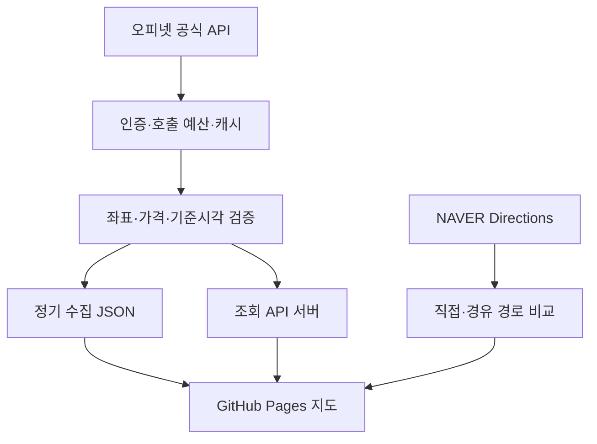

# 주유한눈

**정유사에 관계없이 주유 가격·가격 기준시각·추가 이동 비용을 비교하는 지도 앱.**

- 서비스: [주유한눈](https://softm.github.io/juyuhannun/)
- 추가 정보: [평균유가·고속도로·수소 월평균 안내](https://softm.github.io/juyuhannun/energy.html)
- 저장소: [softm/juyuhannun](https://github.com/softm/juyuhannun)
- 기준 소스: [돌봄한눈](https://github.com/softm/homecare-nationwide-care-services-map/tree/6c3a1fa7a4283f8b53dc0ca6ff5bc9643c45e16d)
- 운영·연동: [OPERATIONS.md](./OPERATIONS.md)
- 공식 데이터 상세: [server/DATA_SOURCES.md](./server/DATA_SOURCES.md)
- 지도 재사용 이력: [public/shared/SOURCE.md](./public/shared/SOURCE.md)

## 현재 상태

지도·검색·필터·상세·찜·공유·절약 계산·오피넷 API 클라이언트·수집기·GitHub Pages 배포 워크플로를 구현했습니다. 2026-10-20 중단된 추가 정보 화면을 복구하고 전국·시도 평균 유가의 서버 조회와 정기 수집을 연결했습니다. 고속도로는 화면·서버 응답·수집 파일 경로까지 준비했으며, 실제 가격 HTTP 연동은 공식 응답 명세 확인이 남아 있습니다.

**API 키가 없으면 실가격 자료는 0건이며 `가격 자료 연결 대기`가 표시됩니다. 임의의 주유소·가격을 실제 자료로 넣지 않습니다.** 오피넷은 `OPINET_API_KEY`를 등록합니다. 고속도로는 현재 `EX_API_KEY`만 등록해도 실가격이 연결되지 않으며 `implementationReady: false`로 표시합니다. 현재 운영 자료 상태는 배포 워크플로의 Summary에서 확인합니다. 도로 경로 비교에는 별도의 서버 및 NAVER Directions 키가 필요합니다. 직접 입력 절약액 계산기는 API 없이 작동합니다.

가격의 정확성을 확인하는 운영 검증은 실제 키 연동 후 수행해야 합니다. 코드 검증과 배포 성공을 실가격 연동 성공으로 간주하지 않습니다.

## 기능

| 영역 | 기능 |
|---|---|
| 지도 | 네이버 지도, 실지도 대체 경로, 위치 요청, 사용자 이동 후 450ms 재조회, 배율 유지 |
| 가격 | 휘발유·경유·고급휘발유·LPG, 모든 정유사 비교, 반경 1/3/5km |
| 필터 | 정유사, 셀프, 24시간 이내 자료, 이름·주소, 가격·직선거리·확인된 절약액 정렬 |
| 신뢰도 | 유종별 가격 기준시각과 수집 시각 분리, 6/24시간 표시, 미확인·미래시각 배제 |
| 이용 | 주유소 상세, 전화·외부 길찾기, 찜, 해당 주유소 중심의 공유 링크 |
| 비용 | 동일 출발지·목적지의 직접/주유소 경유 도로 경로 비교, 연료비·통행료·시간 비용 |
| 계산기 | 사용자가 직접 입력한 단가·주유량·연비·왕복/우회 거리의 예상 절약액 |
| 평균 유가 | 전국·시도·시군구 평균, 유종·지역 필터, 전일 대비 증감, 기준일·수집 시각 분리 |
| 고속도로 | 유종별 가격·휴게소·노선·방향·업체 정보 표시 화면 준비. 실제 가격 연동은 명세 확인 전까지 대기하며 공식 자료 링크 제공 |
| 수소 | 한국석유관리원의 직전월 평균가격 공식 자료 안내. 수소 가격 레코드 수집은 미연동 |
| 수집 | 일반 API 인증, KATEC 좌표 변환, 상세 보강, 캐시·요청 병합·일일 예산, 마지막 정상 자료 보존 |
| 배포 | 정적 파일만 dist에 빌드, 단일 Pages 워크플로, 예정 수집 후 검증·배포 |

## 실행

Node.js 22 이상. 외부 npm 패키지를 설치하지 않아도 됩니다.

```bash
git clone https://github.com/softm/juyuhannun.git
cd juyuhannun
cp .env.example .env
# .env에 발급받은 키를 입력합니다. 공개 파일에 키를 넣지 마세요.
npm run dev
```

[http://localhost:8787](http://localhost:8787)에서 확인합니다. `.env`가 없거나 키가 비어 있어도 지도·입력 계산기와 연동 대기 상태를 확인할 수 있습니다.

```bash
npm test
npm run check
npm run build
npm run collect:energy
```

`dist/` **폴더의 내용**을 서비스 경로에 배포합니다. 프로젝트 Pages 주소는 `/juyuhannun/`이며 `/juyuhannun/dist/`를 주소로 사용하지 않습니다.

## 데이터 경로



### 정적 Pages 기본 운영

GitHub Actions가 공식 API를 수집하고 `public/data/stations.json`을 사이트에 포함합니다. 초기 수집 범위는 **서울시청·대전역 각각 반경 3km, 네 유종**입니다. 이는 호출량을 제한하기 위한 운영 시작 설정이며 전국의 모든 주유소를 수집한 결과가 아닙니다. 지도에는 범위와 부분 자료임을 표시합니다.

### 조회 API 운영

사용자가 지도 중심을 옮길 때마다 주변 자료를 조회하려면 `server/index.mjs`를 HTTPS 서버에서 실행하고, GitHub Actions 변수 `PUBLIC_API_BASE`를 `https://서버주소/api`로 설정합니다. Pages에는 비밀키가 포함되지 않습니다. 도로 경로도 이 서버가 담당합니다.

### 추가 정보 수집

`scripts/collect-energy.mjs`가 `averages.json`과 `highway.json`을 각각 갱신합니다. 전국·시도 평균은 2회 호출하며 기존 주유소 수집과 같은 오피넷 일일 원장을 사용합니다. 도로공사는 별도 원장을 사용합니다. 제공기관별 수집 실패는 다른 기관의 정상 수집을 중단시키지 않습니다. 실패한 자료는 원래의 기준일·가격 시각·수집 시각을 유지하며 `partial`, `cache.stale`, `lastAttempt`로 실패를 표시합니다.

평균 유가는 집계 참고값이며 개별 주유소의 판매가격·지도 마커·절약액 입력으로 사용하지 않습니다. 고속도로도 오피넷 시설과 이름만으로 합치지 않습니다. 전기차 충전소 앱은 별도 프로젝트로 유지합니다.

## 계산 원칙

```text
단가 차이 이득 = (평소 기준 단가 − 선택 주유소 단가) × 주유량
추가 연료비 = 추가 도로거리(km) ÷ 연비(km/L) × 평소 기준 단가
통행료 차이 = 경유 경로 통행료 − 직접 경로 통행료
선택 시간 비용 = 추가 주행시간(시간) × 시간당 비용
예상 절약액 = 단가 차이 이득 − 추가 연료비 − 통행료 차이 − 선택 시간 비용
```

추가 주유 대기·주유시간, 카드 할인·적립, 차량별 실연비 변화는 계산에 자동 반영하지 않습니다. 음수 결과는 추가 비용으로 그대로 표시합니다. 경로가 없거나 거리·시간·통행료 중 하나라도 불명확하면 이동비를 반영한 추천을 만들지 않습니다.

기준 단가는 사용자가 평소 주유하는 가격입니다. 해당 가격으로 기존 이동 경로에서 주유할 수 있다는 가정입니다. 기준 주유소의 별도 우회 이동까지 비교하는 기능은 현재 범위에 포함되지 않습니다.

## 출처와 업데이트

- [오피넷 API 안내](https://www.opinet.co.kr/user/custapi/custApiInfo.do): 일반 API 300회/일, 제휴 시 조건 확대. 전국 기본정보·전체 가격은 프리미엄 제휴 범위.
- [오피넷 가격조사·공개기준](https://www.opinet.co.kr/user/dopds/dopDs_4.do): 카드 단말기 수집 반영 1·2·9·12·16·19시, 직접 보고 입력·수정 시 반영.
- 가격 기준시각은 `TRADE_DT`·`TRADE_TM`을 한국시간으로 해석한 `priceUpdatedAt`입니다. `fetchedAt`으로 대체하지 않습니다.
- `freshness`의 6시간·24시간은 이 앱의 비교 정책입니다. 공식 정확도 보증 또는 현장 가격 일치 보증을 뜻하지 않습니다.

## 개발 기준

일반 웹 화면의 비공개 내부 요청을 역분석하거나, 인증키 없는 전국 실가격 수집을 전제로 운영하지 않습니다. 실제 키 연동과 데이터 이용 범위 확인 후 운영을 활성화합니다. 자동 수집은 사용자 위치를 수집 지역으로 자동 등록하지 않습니다. 원본 돌봄한눈의 의료·시설 데이터, 분석 식별자, 광고 설정, 서버 비밀키는 복사하지 않았습니다.
