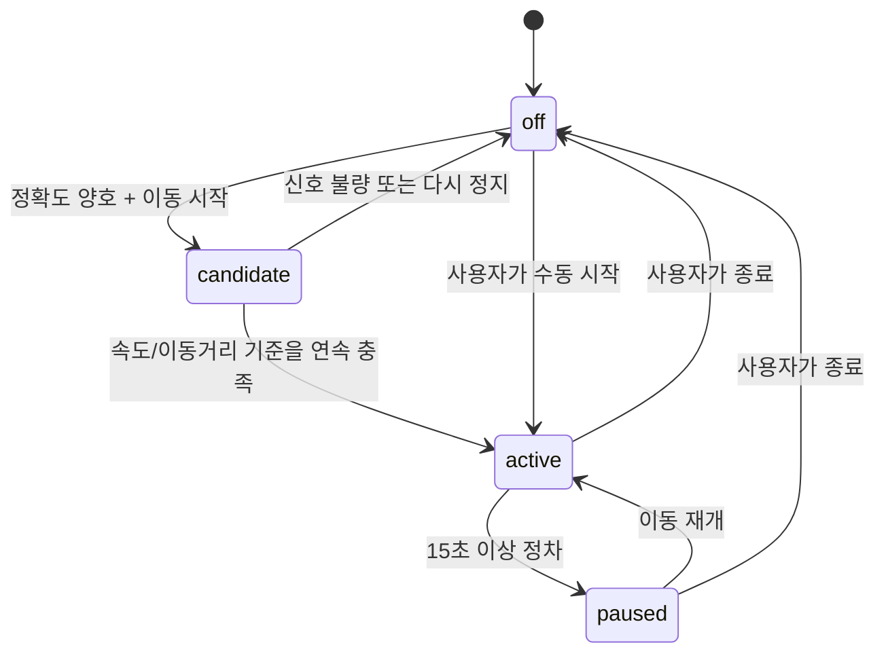

# 주유한눈 주행·가는 길 UX 검토 및 구현 설계

- 작성일: 2026-10-28
- 대상: 웹/PWA와 Android WebView 공통 화면
- 기준 소스: `main` (`c0b5cda`)
- 문서 목적: 사용자 검토 사항을 오류와 추가 구현으로 분리하고, 현재 코드와 연결된 구현·검증 기준을 확정한다.
- 구현 상태: **분석·설계 완료 / 기능 코드는 아직 변경하지 않음**

## 1. 해석 기준

1. “정북”은 **북쪽이 화면 위인 north-up 지도**로 해석한다. 진행 방향은 지도를 회전시키지 않고 현재 위치 화살표로 표시한다.
2. “가는길찾기 목적지 히스토리 넘겨 / 남겨” 중 “넘겨”는 문맥상 “남겨”의 오타로 우선 해석한다. 외부 내비게이션에는 현재도 출발지·경유 주유소·목적지를 구분해 전달한다.
3. “스케일러”는 주행 중 사용할 수 있는 **지도 배율 조절 UI + 두 손가락 핀치 줌 + 자동 배율 복귀 기능**으로 정의한다.
4. 자동 주행 감지는 앱이 화면에 보이는 동안, 사용자가 위치 권한을 허용한 경우에만 동작한다. 백그라운드 위치 권한은 추가하지 않는다.

## 2. 결론 요약

현재 앱에는 현재 위치 조회, 실시간 `watchPosition`, 주행 화살표, 속도별 자동 줌, 목적지 로컬 저장, 브랜드 필터, 드래그 가능한 목록 시트가 이미 있다. 그러나 다음 충돌 때문에 사용자 요구를 충족하지 못한다.

- 주행 위치 추적은 수동 버튼으로만 시작되고, 가는 길 모드 진입 시 오히려 기존 주행 추적을 중지한다.
- 정지·저속에서도 GPS가 주는 불안정한 방향값을 그대로 사용하고, 방향이 없으면 북쪽 `0°`를 강제로 사용한다.
- 주행 중 핀치 줌을 비활성화하고, 매 위치 갱신마다 속도 기준 줌을 다시 적용해 사용자의 확대·축소를 덮어쓴다.
- 최근 목적지는 체크박스를 선택한 경우에만 최대 5개 저장되어 “히스토리가 남는다”는 기대와 다르다.
- 모바일에서는 브랜드 선택 UI가 숨겨져 있고, 지도 마커는 브랜드와 무관한 공통 주유기 아이콘만 사용한다.
- 가는 길 결과의 녹색 별은 찜이 아니라 “추천만/전체” 전환 버튼이다. 아이콘만으로 기능을 알 수 없다.
- 결과 목록의 기본 높이는 화면의 약 54%이므로 요청한 50%와 다르다.

## 3. 요구사항별 현재 상태와 처리 방향

| ID | 검토 사항 | 분류 | 현재 상태·원인 | 구현 결정 | 우선순위 |
|---|---|---|---|---|---|
| R-01 | 출발지를 현재 위치로 자동 설정 | 보완 | 초기 위치는 얻지만 `lastLocatedPoint`에 시각·정확도가 없고 오래된 좌표도 재사용할 수 있음 | 최신 위치의 시각·정확도를 관리하고, 가는 길 진입 시 유효한 최신 위치만 자동 출발지로 사용 | P0 |
| R-02 | 주행 중 현재 위치 반영 | 오류 | 수동 주행모드에서는 반영하지만 가는 길 진입 시 `stopDrivingMode()`를 호출 | 위치 세션을 화면 모드와 분리하고 가는 길에서도 같은 실시간 위치를 계속 사용 | P0 |
| R-03 | 주행 진입 시 현 위치 + 정북 표시 | 보완 | 기본 지도는 정북이지만 메서드명이 heading-up이고, 첫 방향 미확인 시 북쪽 화살표를 강제로 표시 | 지도는 항상 정북, 방향이 확인되기 전에는 중립 위치점, 확인 후 차량 화살표 표시 | P0 |
| R-04 | 정차 시 진행 방향이 틀어짐 | 오류 | 저속·정지 상태의 `coords.heading`도 채택하고 마지막 신뢰 방향을 오염시킴 | 이동거리·속도·정확도 기반 방향 신뢰 판정, 원형 평균, 정차 시 마지막 신뢰 방향 고정 | P0 |
| R-05 | 주행 상태 자동 판단·자동 진입 | 신규 | 수동 주행 버튼만 존재 | `off → candidate → active → paused` 상태 머신과 수동 해제 우선 정책 구현 | P0 |
| R-06 | 주행 중 배율 스케일러 | 오류+신규 | GPS 갱신마다 zoom 13/14/15로 덮어씀 | 자동/수동 배율 모드, 접근 가능한 배율 슬라이더, `+/-`, 자동 복귀 버튼 구현 | P0 |
| R-07 | 주행 중 두 손가락 배율 조정 | 오류 | Naver `pinchZoom:false`, Leaflet `touchZoom.disable()` | 한 손가락 이동은 잠그되 핀치 줌은 허용하고, 핀치 후 수동 배율로 전환 | P0 |
| R-08 | 목적지 히스토리 저장 | 보완 | 선택 체크박스가 켜졌을 때만 최대 5개 저장 | 성공한 경로 목적지를 기기에 자동 저장, 최대 10개, 중복 병합·개별 삭제·전체 삭제 제공 | P1 |
| R-09 | 찜한 곳을 하단 더보기에 추가 | 신규 | 상단 탭에만 있고 하단 더보기는 안내 창 또는 경로 변경으로 사용 | 모바일 더보기 시트에 `찜한 곳 (n)` 추가. 데스크톱 상단 탭은 유지 | P1 |
| R-10 | 가는 길 종료 시 지도 안 주유소로 복귀 | 오류 | 사용자가 누른 탭에 따라 `saved`로도 이동하며 종료 동작이 명시적이지 않음 | 공통 `exitRouteMode()`를 만들고 기본 대상은 항상 `nearby`; 명시적으로 찜을 선택한 경우만 예외 | P0 |
| R-11 | 주유소 브랜드 아이콘 | 신규 | 목록에는 텍스트, 마커에는 공통 주유기 아이콘만 표시 | 가격 색상은 유지하고 별도 브랜드 배지를 마커·목록·상세에 추가 | P1 |
| R-12 | 브랜드 필터 검색 | 오류+보완 | 로직과 데스크톱 select는 있으나 모바일 CSS가 select를 숨김 | 모바일 필터 시트에 브랜드 칩/선택 UI 노출, 일반·가는 길 모드에 동일 적용 | P1 |
| R-13 | 가는 길 결과 목록 기본 50% | 보완 | JS와 CSS 기본값이 54% | 광고·safe area를 제외한 사용 가능 높이의 50%로 기본 스냅 설정 | P1 |
| R-14 | 녹색 별 아이콘 의미 명확화 | 사용성 오류 | 실제 기능은 추천 결과/전체 결과 전환인데 찜처럼 보임 | 아이콘 단독 버튼을 `추천 3 / 전체 n` 텍스트가 보이는 전환 컨트롤로 변경 | P0 |

## 4. 현재 코드에서 확인된 직접 원인

### 4.1 위치·주행

- `public/js/app.js:365-379`: 가는 길 모드 진입 시 활성 주행모드를 중지한다.
- `public/js/app.js:469-473`: 현재 위치 출발지는 `lastLocatedPoint`를 재사용하지만 시각·정확도 검증이 없다.
- `public/js/map.js:994-1068`: 실시간 위치는 수동 `startDriving()` 호출 후에만 시작한다.
- `public/js/map.js:1011-1016`: 저속 여부와 무관하게 GPS heading을 사용하고, 값이 없으면 마지막 값 또는 `0°`를 사용한다.
- `public/js/map.js:1027-1038`: 모든 위치 갱신에서 속도에 따라 줌 13/14/15를 다시 설정한다.
- `public/js/map.js:897-912`: 주행 중 드래그뿐 아니라 Naver 핀치 줌과 Leaflet 터치 줌까지 함께 비활성화한다.

### 4.2 가는 길·목록·메뉴

- `public/js/app.js:462-467`: 최근 목적지는 체크박스 선택 시에만 최대 5개 저장한다.
- `public/js/app.js:364-380`: 가는 길 종료를 전담하는 함수가 없고 일반 보기 전환 로직에 섞여 있다.
- `public/js/app.js:231-238`, `public/index.html:91`: 녹색 별은 찜이 아니라 추천 결과/전체 결과 범위 전환이다.
- `public/js/mobile-map-view.js:151-169`: 목록의 medium 스냅은 화면 높이의 54%다.
- `public/mobile-map.css:244-245`: CSS 폴백도 `54dvh`다.
- `public/js/app.js:334-343`: 하단 더보기는 일반 모드에서 안내 창, 경로 모드에서 경로 변경으로 동작해 메뉴 확장이 어렵다.

### 4.3 브랜드

- `public/js/core.js:5`, `public/js/core.js:77-86`: 브랜드명과 필터 로직은 이미 있다.
- `public/index.html:37`: 데스크톱 브랜드 select도 이미 있다.
- `public/mobile-map.css:425-430`: 모바일 지도 모드에서는 브랜드 select를 강제로 숨긴다.
- `public/js/map.js:740-750`: 마커 내용은 브랜드와 무관한 공통 주유기 SVG다.

### 4.4 개인정보 안내 불일치

- `public/index.html:109`는 브라우저 저장 항목을 찜과 유종으로만 설명하지만, 선택 시 목적지 좌표도 저장한다.
- `public/privacy.html:23-31`도 목적지 히스토리의 저장·삭제 방법을 구체적으로 알리지 않는다.
- 앱 시작 시 `public/js/app.js:596-610`에서 위치를 자동 요청하므로 “사용자가 위치 버튼을 누른 경우에만”이라는 현재 안내와도 차이가 있다.

목적지 자동 히스토리와 자동 주행 감지를 배포하기 전, 실제 처리 방식과 안내 문구를 반드시 일치시켜야 한다.

## 5. 목표 상태 모델

### 5.1 위치 세션은 보기 모드와 분리

`nearby`, `route`, `saved` 보기와 GPS watch 생명주기를 분리한다. 하나의 위치 watch만 두고 모든 화면이 같은 최신 fix를 구독한다.

```js
state.location = {
  permission: 'unknown' | 'prompt' | 'granted' | 'denied',
  watching: false,
  point: null,
  accuracyMeters: null,
  speedMps: null,
  rawHeading: null,
  reliableHeading: null,
  timestamp: null
};

state.driving = {
  phase: 'off' | 'candidate' | 'active' | 'paused',
  startedBy: null | 'manual' | 'auto',
  autoEnabled: true,
  autoSuppressed: false,
  follow: true,
  zoomMode: 'auto' | 'manual',
  manualZoom: null
};
```

- 수동으로 주행모드를 끄면 같은 앱 세션에서는 자동 재진입하지 않는다. 사용자가 “자동 감지 켜기”를 다시 선택해야 해제된다.
- `document.hidden === true`가 되면 watch를 정리한다. 화면 복귀 시 권한과 설정을 확인해 다시 시작한다.
- 위치 권한이 거부되면 수동 출발지·지도 탐색은 계속 가능해야 한다.
- Android도 백그라운드 위치 권한을 추가하지 않는다.

### 5.2 자동 주행 상태 머신



초기 판정값은 다음과 같이 잡고 실기기 로그로 조정한다.

- 유효 fix: 정확도 `<= 65m`, 시각 역전 없음.
- 가는 길 경로가 있는 경우: `speed >= 2.8m/s`가 6초 이상이거나 12초 동안 40m 이상 이동하면 candidate → active.
- 경로가 없는 경우: 오탐을 줄이기 위해 `speed >= 5.5m/s`가 8초 이상이거나 15초 동안 90m 이상 이동하면 active.
- 정차: `speed < 1.0m/s`이고 15초 동안 유효 이동이 10m 미만이면 paused.
- 정확도가 나쁜 fix, 순간적인 한 번의 속도값, GPS 점프는 상태 전이에 사용하지 않는다.

자전거·전동킥보드와 차량은 GPS만으로 완벽히 구분할 수 없다. 따라서 자동 감지는 설정에서 끌 수 있어야 하며, 수동 종료가 항상 우선한다.

## 6. 방향 안정화 설계

### 6.1 신뢰 방향 계산

방향은 다음 우선순위로 결정한다.

1. 속도 `>= 2.0m/s`이고 GPS heading이 유효하면 사용한다.
2. heading이 없거나 신뢰할 수 없으면, 정확도 오차보다 충분히 큰 실제 이동 두 점으로 bearing을 계산한다.
3. 새 방향과 이전 방향은 일반 산술평균이 아니라 359°→1° 경계를 처리하는 원형 지수평균으로 완화한다.
4. 정차·저속에서는 새 GPS heading을 버리고 마지막 신뢰 방향을 유지한다.
5. 아직 신뢰 방향이 한 번도 없으면 `0°`를 만들지 않고 `null`로 유지해 원형 현재 위치점만 표시한다.

권장 순수 함수:

```js
updateHeadingFilter(previous, fix) => {
  reliableHeading,
  source: 'gps' | 'movement' | 'held' | 'unknown',
  confidence: 0..1
}
```

### 6.2 지도 방향

- 지도·도로명·주유소 라벨은 항상 정북을 유지한다.
- `_setDrivingHeadingUp()`는 실제로 지도를 회전하지 않으므로 `_setDrivingGuidanceState()`로 이름을 바꾼다.
- 차량 화살표만 `reliableHeading`으로 회전한다.
- paused가 30초 이상 이어지면 화살표를 흐리게 표시하고 “정차 중” 상태를 노출한다.
- 지도 제공자가 바뀌거나 화면이 resize되어도 정북과 마지막 신뢰 방향이 유지되어야 한다.

## 7. 현재 위치·출발지·경로 진행 설계

### 7.1 출발지 자동 설정

`lastLocatedPoint`를 단순 좌표 대신 `{lat,lng,accuracy,timestamp}`로 저장한다.

- 가는 길 진입 시 `15초 이내 + 정확도 65m 이내` fix면 즉시 “현재 위치(실시간)” 출발지로 사용한다.
- 조건을 만족하지 않으면 새 위치를 요청하고, 그동안 경로 찾기 버튼은 비활성화한다.
- 사용자가 주소나 지도로 출발지를 직접 지정하면 `originMode='manual'`로 바꾸고 이후 GPS가 덮어쓰지 않는다.
- 사용자가 “현재 위치 사용”을 누르면 다시 `originMode='live'`로 전환한다.
- 경로 요청 직전에 최신 fix를 한 번 더 확인해 계획 출발 좌표를 확정한다.

### 7.2 주행 중 경로 표시

- 계획에 사용한 출발지는 `plannedOrigin`으로 고정해 거리·시간·우회 계산의 기준을 보존한다.
- 실시간 현재 위치는 `livePosition`으로 별도 관리하며, 경로 응답을 매 fix마다 무효화하지 않는다.
- 기본 경로 polyline에 현재 위치를 투영해 `routeProgressMeters`와 `offRouteMeters`를 계산한다.
- 주행 중 목록은 현재 진행 지점보다 300m 이상 뒤에 있는 후보를 기본 숨김 처리한다. 사용자가 선택한 후보는 유지한다.
- 경로에서 100m 이상 벗어난 fix가 3회 연속이면 “경로를 벗어났습니다. 현재 위치에서 다시 탐색”을 제안한다. 자동 재탐색은 API 호출량과 화면 튐 때문에 기본 동작으로 두지 않는다.

## 8. 주행 지도 배율 설계

### 8.1 자동 배율

초기 자동 배율은 속도 구간별로 설정하되, 한 번의 GPS 값으로 즉시 변하지 않게 5초 히스테리시스를 둔다.

| 속도 | 목표 zoom |
|---|---:|
| 정차~10km/h | 16 |
| 10~40km/h | 15 |
| 40~80km/h | 14 |
| 80km/h 이상 | 13 |

- 한 번에 1단계씩, 최소 2초 간격으로 변경한다.
- 신뢰 방향이 없으면 진행방향 선행 중심을 만들지 않고 현재 위치를 중심으로 둔다.
- 신뢰 방향이 있으면 현재처럼 진행방향 앞쪽을 더 보여 주되, 배율과 화면 높이에 따라 선행 거리를 계산한다.

### 8.2 수동 배율과 핀치

- Naver: `draggable:false`, `scrollWheel:false`, `pinchZoom:true`.
- Leaflet: `dragging.disable()`, `touchZoom.enable()`, `scrollWheelZoom.disable()`.
- 사용자가 핀치, `+/-`, 스케일러를 조작하면 `zoomMode='manual'`로 전환한다.
- 수동 모드에서는 GPS fix가 와도 줌을 바꾸지 않고 중심만 추적한다.
- `자동` 버튼을 누르면 속도 기반 배율로 복귀한다.
- 배율 스케일러는 zoom 12~18, step 1 범위의 접근 가능한 `input[type=range]`로 제공하고 현재 값과 자동/수동 상태를 텍스트로 표시한다.

수락 기준: 사용자가 zoom 17로 조정한 뒤 GPS fix가 10회 들어와도 17이 유지되고, 두 손가락 핀치가 실제 지도 배율을 바꿔야 한다.

## 9. 가는 길 화면 전환 설계

### 9.1 명시적 진입·종료 함수

현재 `selectView()`에 섞인 로직을 다음 함수로 분리한다.

```js
enterRouteMode()
exitRouteMode({ target: 'nearby' | 'saved' = 'nearby', clearPlan = false })
```

- 일반적인 닫기, 뒤로가기, 경로 종료는 `target:'nearby'`를 사용한다.
- 더보기에서 사용자가 명시적으로 “찜한 곳”을 선택한 경우만 `target:'saved'`를 허용한다.
- 종료 시 경로선·경유선·모의주행·선택 마커를 정리하고 지도 안 주유소 목록을 다시 렌더링한다.
- 주행 추적 중이면 오래된 진입 전 지도 snapshot보다 현재 위치를 우선한다.
- 계획 결과는 메모리에 보존해 재진입 시 “최근 경로 이어보기”가 가능하게 하고, “경로 완전 종료”에서만 삭제한다.

### 9.2 녹색 별 버튼

현재 별 아이콘 단독 버튼은 제거하거나 다음과 같이 의미가 보이는 컨트롤로 바꾼다.

- 추천만 표시 중: `★ 추천 3`
- 전체 표시 중: `≡ 전체 18`
- 목록 시트의 결과 헤더에도 같은 상태를 표시한다.
- 찜 기능에는 기존 하트만 사용해 별과 하트 의미가 섞이지 않게 한다.

## 10. 목적지 히스토리 설계

### 10.1 저장 정책

- 경로 탐색이 성공한 목적지를 자동 저장한다.
- 기기 로컬 저장만 사용하고 서버에는 목적지 히스토리를 저장하지 않는다.
- 최대 10개, 최근 사용 순으로 정렬한다.
- 좌표가 50m 이내이거나 정규화된 이름과 좌표가 같은 항목은 하나로 병합한다.
- 저장 필드: `id`, `label`, `lat`, `lng`, `lastUsedAt`, `useCount`.
- 이동 궤적, 출발지 히스토리, 경로 polyline은 저장하지 않는다.

키는 `juyu:route-destinations:v2`를 사용하고 기존 v1 최대 5개 자료를 최초 한 번 마이그레이션한다.

### 10.2 UI

- 목적지 검색창을 열면 최근 목적지를 먼저 보여 준다.
- 각 항목에 선택, 개별 삭제를 제공한다.
- 더보기 메뉴에 “최근 목적지 관리”와 “전체 삭제”를 제공한다.
- “이 기기에만 저장됩니다” 문구와 자동 저장 끄기 설정을 제공한다.

`public/index.html` 이용 안내와 `public/privacy.html`에는 목적지 좌표·이름의 기기 저장, 삭제 방법, 경로 제공업체 전달을 명시한다.

## 11. 찜한 곳과 하단 더보기 설계

모바일의 하단 더보기 버튼은 안내 dialog를 바로 열지 않고 메뉴 bottom sheet를 연다.

메뉴 최소 항목:

1. `찜한 곳` + 저장 개수
2. `최근 목적지`
3. `주행 자동 감지` 켜기/끄기
4. `데이터·가격 기준 안내`
5. `개인정보처리방침`

`찜한 곳`을 선택하면 `selectView('saved')` 후 목록 시트를 연다. 데스크톱의 기존 상단 `찜한 곳` 탭은 유지한다. 가는 길 모드에서 더보기를 열어 찜을 명시적으로 선택한 경우에는 기본 nearby 복귀 규칙보다 사용자의 명시적 선택을 우선한다.

## 12. 브랜드 아이콘·필터 설계

### 12.1 브랜드 표시

가격 색상과 브랜드 색상을 같은 영역에 사용하지 않는다.

- 마커 본체: 기존처럼 가격 수준(저렴/보통/비쌈/참고) 색상 유지.
- 마커 모서리: 작은 브랜드 배지 추가.
- 목록 카드: 주유소명 앞 또는 보조 정보 줄에 브랜드 배지와 전체 이름 표시.
- 상세: 기존 브랜드 텍스트 앞에 동일 배지 사용.

신규 상수 예시:

```js
BRAND_VISUALS = {
  SKE: { short: 'SK', label: 'SK에너지' },
  GSC: { short: 'GS', label: 'GS칼텍스' },
  HDO: { short: 'HD', label: 'HD현대오일뱅크' },
  SOL: { short: 'S', label: 'S-OIL' },
  RTE: { short: '알', label: '알뜰주유소' },
  RTX: { short: '고', label: '고속도로 알뜰' },
  NHO: { short: 'NH', label: '농협 알뜰' },
  ETC: { short: '자', label: '자가상표' },
  E1G: { short: 'E1', label: 'E1' },
  SKG: { short: 'SK', label: 'SK가스' }
};
```

공식 로고 파일을 사용할 경우에는 별도 라이선스·상표 사용 조건을 확인한다. 1차 구현은 외부 이미지 요청이 없는 텍스트/SVG 배지로 진행한다.

### 12.2 브랜드 필터

- 모바일 `추가 필터` 안에 `전체 / SK / GS / HD / S-OIL / 알뜰 / 기타` 칩을 노출한다.
- 접근성 이름은 약칭이 아니라 전체 브랜드명으로 제공한다.
- 일반 지도는 기존 `state.brand`와 `filterStations()`를 그대로 재사용한다.
- 가는 길 결과에서 브랜드 변경 시 기존 경로선은 유지하고 결과를 필터한다.
- 해당 브랜드의 우회 검증 후보가 부족하면 “이 브랜드 기준으로 다시 탐색” 버튼을 제공한다. 필터 변경만으로 방향 API를 자동 반복 호출하지 않는다.

## 13. 가는 길 목록 기본 높이 50%

- 경로 탐색 성공 후 `openListSheet({snap:'half'})`를 호출한다.
- half 높이는 `visualViewport.height`에서 하단 광고와 safe area를 제외한 **사용 가능 높이의 50%**로 계산한다.
- CSS 폴백은 `50dvh`로 변경한다.
- 기존 compact 약 38%, expanded 84% 스냅과 드래그 종료 규칙은 유지한다.
- 주소창 축소, 화면 회전, 광고 높이 변경 때 다시 계산한다.

수락 기준:

- 광고가 없는 세로 화면: 목록 시트 48~52%.
- 하단 광고가 있는 화면: 광고 위 사용 가능 영역 기준 48~52%.
- 가로 화면과 650px 이하 화면에서도 헤더와 첫 카드 핵심 정보가 보여야 한다.

## 14. 권장 모듈 분리

| 파일 | 역할 |
|---|---|
| 신규 `public/js/driving-controller.js` | 자동 주행 상태 머신, heading 안정화, 자동/수동 zoom 정책을 순수 함수 중심으로 제공 |
| 신규 `public/js/location-session.js` | 단일 geolocation watch, 권한·visibility·구독자 생명주기 관리 |
| 신규 `public/js/brand-visuals.js` | 브랜드 배지 메타데이터와 안전한 렌더링 헬퍼 |
| `public/js/map.js` | 위치점·차량 화살표·카메라·pinch/zoom 반영. 판정 로직은 제거 |
| `public/js/app.js` | 보기 전환, route/live position 연결, 메뉴·히스토리·필터 조정 |
| `public/js/route-mode.js` | `plannedOrigin`, live route progress, 재탐색 제안 상태 |
| `public/js/mobile-map-view.js` | half 목록 스냅과 더보기 bottom sheet 연결 |
| `public/index.html` | 배율 스케일러, 더보기 메뉴, 최근 목적지, 브랜드 필터 UI |
| `public/mobile-map.css`, `public/styles.css` | 주행 상태·브랜드 배지·50% 시트·명시적 추천/전체 토글 스타일 |
| `public/privacy.html` | 자동 위치 처리와 목적지 로컬 히스토리 안내 |
| Android `MainActivity.kt` | 필요 시 WebView pause/resume 수명주기만 보완; 백그라운드 위치 권한 추가 없음 |

위치 fix마다 전체 `render()`를 호출하면 목록 DOM과 마커를 반복 생성하므로 자동 추적에서 비용이 커진다. 현재 위치점·카메라는 지도에 즉시 반영하되, 진행 방향 주유소 재정렬은 `1초 또는 25m 이동` 단위, 목록 DOM 갱신은 최대 2초에 한 번으로 제한한다.

## 15. 구현 순서

### 1단계 — 주행 핵심 오류(P0)

1. 위치 세션과 주행 상태 머신을 순수 모듈로 분리한다.
2. 정지 heading 안정화와 `null` 방향 표시를 구현한다.
3. 가는 길 진입 시 주행 추적을 중단하는 코드를 제거한다.
4. 자동/수동 zoom과 핀치 줌을 구현한다.
5. 현재 위치 기반 route progress를 연결한다.

### 2단계 — 화면 전환·오해 방지(P0)

1. `enterRouteMode/exitRouteMode`를 분리한다.
2. 기본 종료 대상을 지도 안 주유소로 고정한다.
3. 녹색 별 아이콘 단독 버튼을 명시적 추천/전체 전환으로 교체한다.

### 3단계 — 모바일 결과 UX(P1)

1. 결과 목록 half 50% 스냅을 적용한다.
2. 더보기 bottom sheet와 찜한 곳 진입을 추가한다.
3. 목적지 히스토리 v2, 삭제·관리 UI, 개인정보 문구를 적용한다.

### 4단계 — 브랜드(P1)

1. 브랜드 배지를 지도·카드·상세에 추가한다.
2. 모바일 브랜드 필터를 노출한다.
3. 가는 길 필터 후 검증 부족 상태와 재탐색 흐름을 처리한다.

### 5단계 — 실기기 검증

1. Android WebView 위치 권한 최초 허용/거부/재허용.
2. 주행→정차→재출발 방향 유지.
3. 핀치 줌 후 여러 GPS 갱신 동안 배율 유지.
4. 하단 광고가 있을 때 50% 목록과 터치 영역.
5. 화면 잠금·앱 전환 후 foreground 복귀와 watch 재시작.

## 16. 자동화 테스트 설계

### 신규 단위 테스트

- `tests/driving-controller.test.mjs`
  - 정지 중 80°→230° 노이즈가 들어와도 80° 유지.
  - 359°→1° 변화가 180°로 튀지 않음.
  - 신뢰 방향이 없을 때 0°를 만들지 않음.
  - 불량 정확도와 한 번의 속도 스파이크로 자동 진입하지 않음.
  - 연속 이동 시 candidate→active, 정차 시 active→paused, 재출발 시 active.
  - 수동 종료 후 자동 재진입 억제.
  - 수동 zoom이 GPS 갱신으로 덮어써지지 않음.

- `tests/location-session.test.mjs`
  - watch 중복 생성 방지.
  - hidden 시 clearWatch, visible 시 조건부 재시작.
  - 위치 권한 거부 후 수동 출발지 사용 가능.

- `tests/route-history.test.mjs`
  - 성공한 목적지 자동 저장, 50m 중복 병합, 최근 10개 제한.
  - v1→v2 마이그레이션, 개별/전체 삭제.

- `tests/brand-visuals.test.mjs`
  - 모든 알려진 브랜드 코드에 라벨·배지 존재.
  - 알 수 없는 브랜드가 안전한 기본 배지로 표시.

### 기존 회귀 테스트 변경

- `tests/mobile-map-focus.test.mjs`: `54dvh`, `viewport*.54` 기대를 50% half 스냅으로 변경.
- `tests/address-route-return.test.mjs`: 경로 종료가 nearby로 복귀하는지 추가.
- `tests/route-mode.test.mjs`: live position이 계획 응답을 매번 무효화하지 않는지 추가.
- `tests/marker-rendering.test.mjs`: 가격 tone과 브랜드 배지가 동시에 유지되는지 추가.
- 현재 별 아이콘을 전제로 한 테스트는 추천/전체 텍스트 전환 기준으로 변경.

## 17. 최종 수락 시나리오

1. 앱이 위치 권한을 얻은 뒤 가는 길을 열면 최신 현재 위치가 출발지로 자동 표시된다.
2. 목적지를 선택하고 주행하면 현재 위치점이 이동하며 경로 진행 지점과 남은 후보가 갱신된다.
3. 진행 방향 85°로 달리다 정차했을 때 GPS가 임의 heading을 주어도 차량 화살표가 다른 방향으로 튀지 않는다.
4. 주행 감지 조건을 연속 충족하면 자동 주행모드에 들어가고, 한 번의 GPS 점프로는 진입하지 않는다.
5. 주행 화면은 정북이며 차량 화살표만 진행 방향을 표시한다.
6. 주행 중 두 손가락 핀치와 스케일러로 배율을 바꿀 수 있고 GPS 갱신이 수동 배율을 덮어쓰지 않는다.
7. 가는 길을 닫으면 기본적으로 지도 안 주유소 화면이 보인다.
8. 성공한 목적지는 최근 목적지에 남고, 사용자가 개별 또는 전체 삭제할 수 있다.
9. 모바일 더보기에서 찜한 곳으로 이동할 수 있다.
10. 오른쪽 결과 범위 버튼만 보아도 추천만 표시 중인지 전체 표시 중인지 알 수 있다.
11. 지도·카드에서 가격 수준과 브랜드를 동시에 구분할 수 있다.
12. 모바일 필터에서 브랜드를 선택하면 일반 지도와 가는 길 결과에 일관되게 반영된다.
13. 가는 길 검색 직후 목록이 광고를 제외한 사용 가능 화면의 약 50% 높이로 열린다.

## 18. 배포 전 주의사항

- 자동 주행 감지는 안전 보조 기능이 아니며 실제 내비게이션을 대체한다고 표현하지 않는다.
- GPS heading·speed는 기기와 브라우저별 편차가 있으므로 단위 테스트만으로 완료 처리하지 않는다.
- 위치·목적지 처리 방식이 바뀌므로 개인정보처리방침과 앱 내 안내를 코드와 같은 배포에 포함한다.
- Android 저장소에는 현재 다른 미커밋 변경이 있으므로 실제 구현 시 관련 파일만 분리해 작업하고 기존 변경을 보존한다.
- 기존 테스트 232개가 모두 통과하는 상태를 기준선으로 유지한다.
